# Septa
### Your materials. Your story. Still yours to edit.

An AI presentation studio that brings source material, visual references, generation and native editing into one workspace. **Startup prototype · development paused since 11 October 2026 · implementation private.**

[Watch the 70-second overview](media/demo.mp4) · [Inspect the exported PDF](media/example.pdf) · [Download the editable PowerPoint](media/example.pptx) · [HTML export](media/example.html)

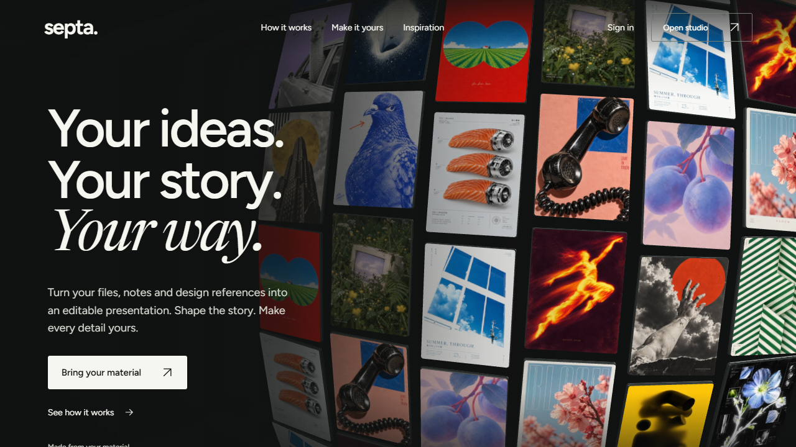

## Start with material, not an empty prompt

A presentation rarely starts with finished copy. It starts with research, reference images, links, spreadsheets and half-formed notes. Septa lets the creator assign each input a role: **content and facts**, **visual reference**, or **both**. The narrative and visual direction can then be developed separately before they meet in the same slide.

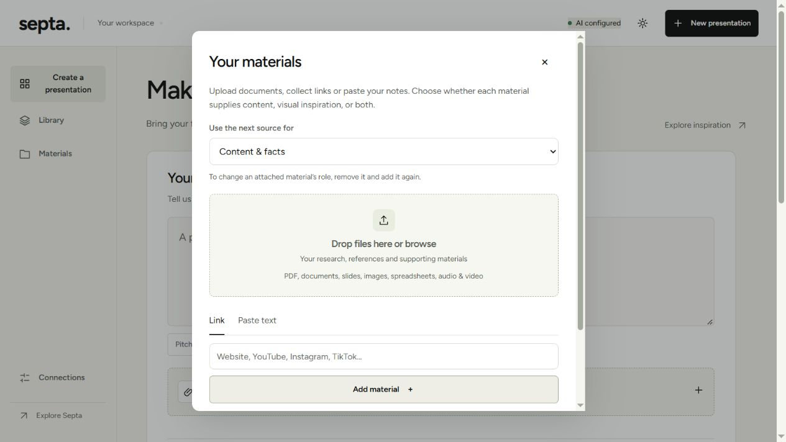

Text and image intake were verified in the preserved local workflows. Parsers and adapters cover a broader range of documents, links and audio/video inputs, with coverage dependent on format and configured providers. The source record keeps page, cell or time references where extraction supports them.

## A document you can continue to shape

The studio stores text, shapes and images as editable objects. A user can change a title, move an element, adjust its properties and save the result. Scoped AI edits pass through document operations, keeping accepted work under the creator’s control. Undo, redo and reload were exercised in bounded verification journeys.

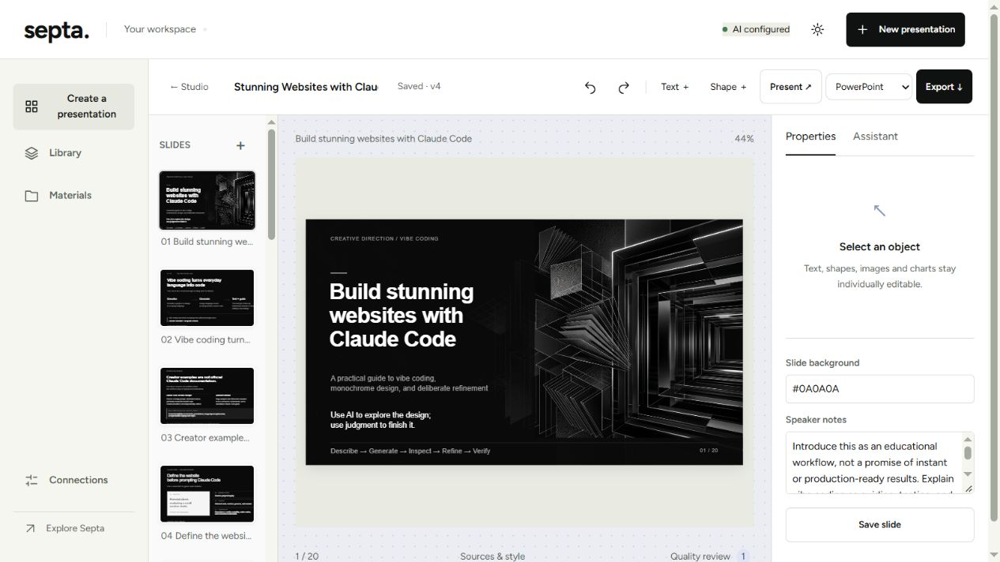

The preserved implementation combines the cinematic frontend with a Fastify/SQLite backend. Durable jobs, checkpoints and provider-attempt records allow interrupted work to continue. The tested AI configuration used **OpenAI and Google Vertex AI**. The example deck’s title mentions Claude Code as its subject; that is not a claim that Septa used the Claude API.

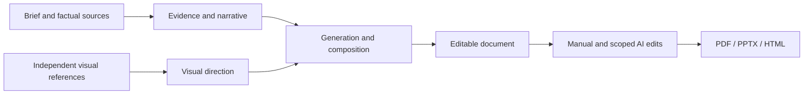

## Follow a preserved workflow

[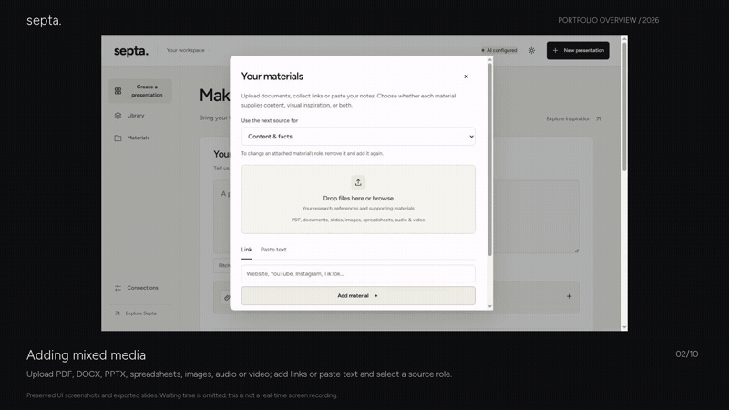](media/demo.mp4)

The full **70-second, silent overview** is assembled from actual application screenshots and exported slides. It is a screenshot-based demonstration with waiting time omitted. Its scoped AI-edit scene comes from a separate, fictional two-slide test; the larger presentation is the recovered 20-slide run.

Inspect the larger generation and the separate AI-edit test

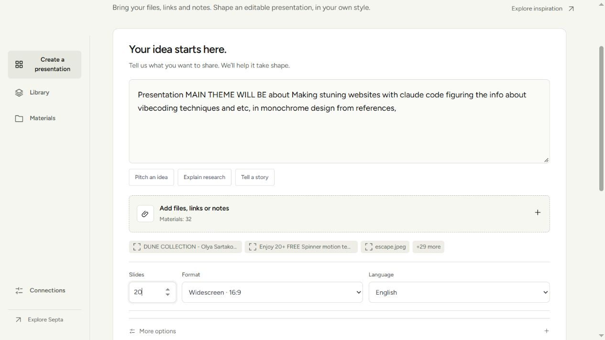

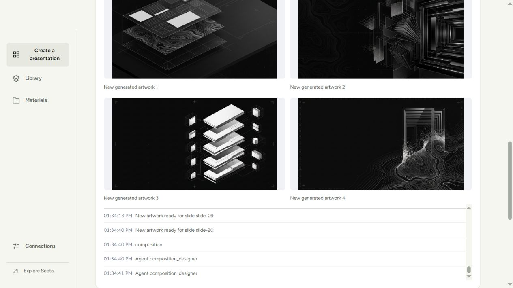

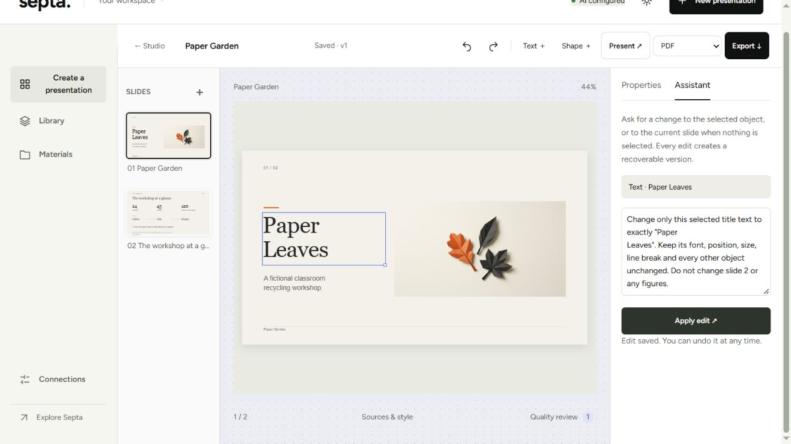

## Inspect the result, not just the interface

The same recovered presentation is available as [PDF](media/example.pdf), [editable PPTX](media/example.pptx) and [self-contained HTML](media/example.html). Its 20-slide overview is shown below. These are actual exports retained from the application.

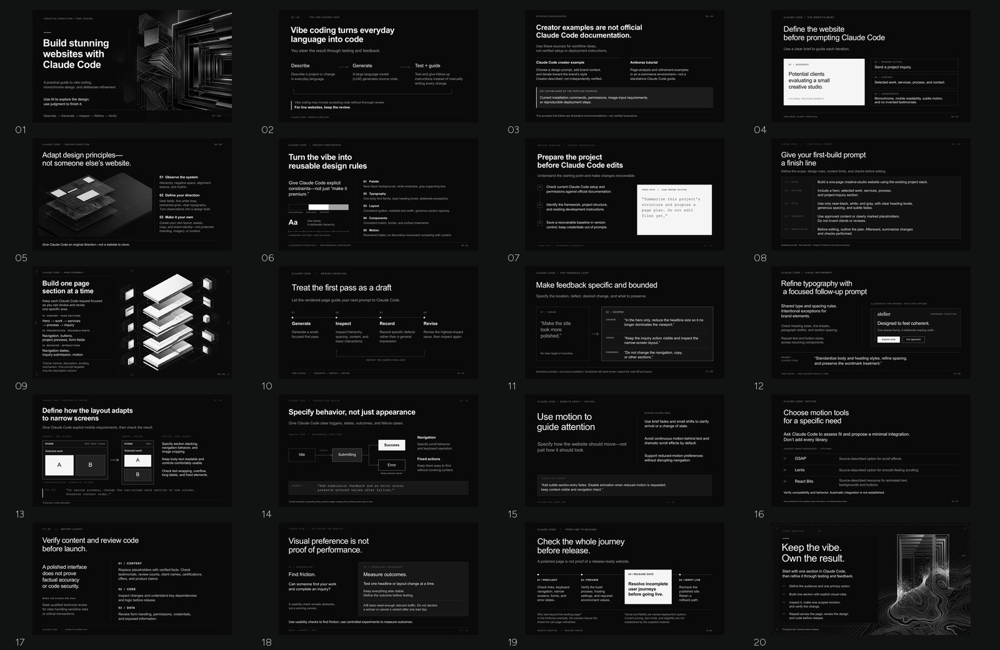

View four exported pages at a readable size

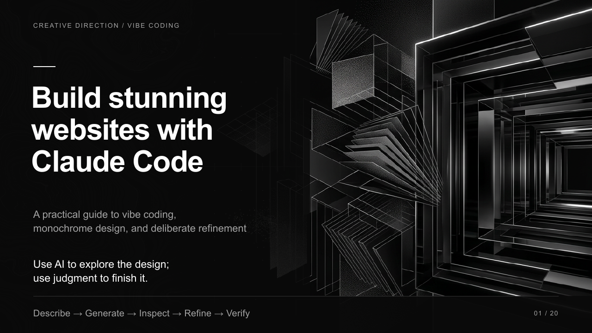

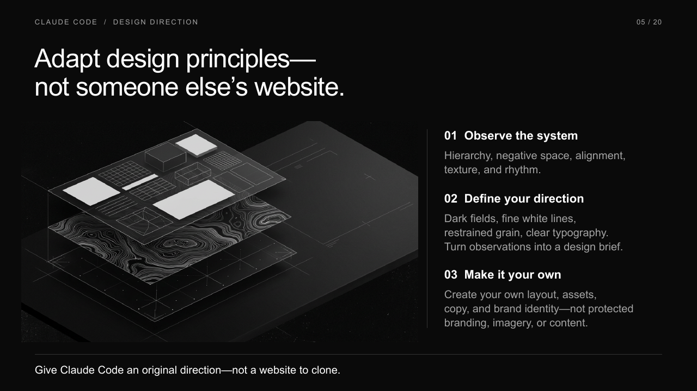

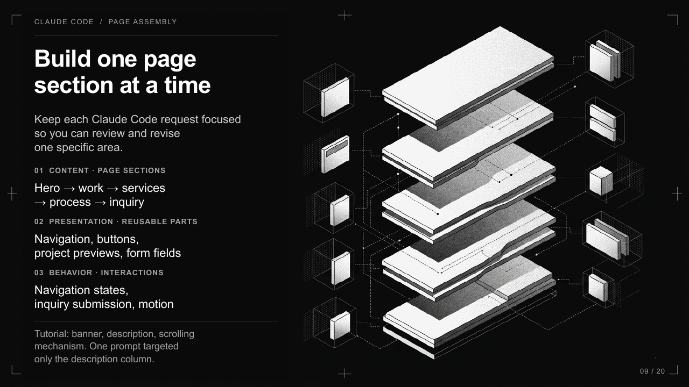

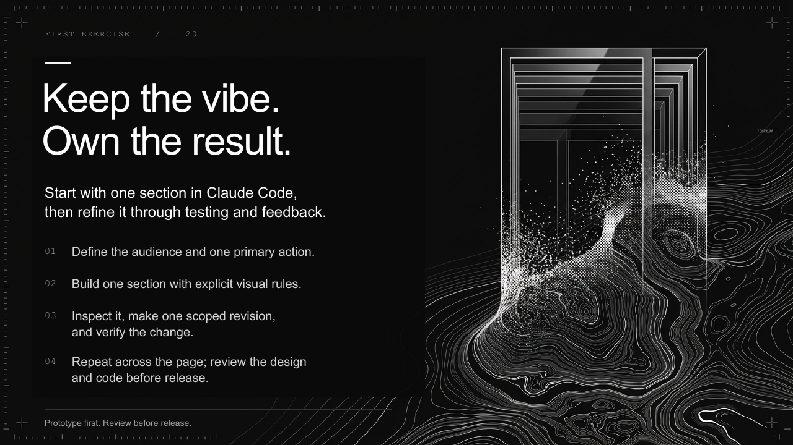

## What worked, and where the project stopped

| Area | Preserved result |
|---|---|
| Intake | Actual text/image uploads, source roles and linked material |
| Generation | Connected provider calls; a bounded two-slide journey and a recovered 20-slide run |
| Editing | Native objects, scoped title changes, exact Undo restoration, saved state and notes |
| Recovery | Continuation of the larger job from durable checkpoints |
| Export | PDF, editable PPTX and portable HTML of the same recovered document |

The larger run exposed slow generation, incomplete source coverage and unresolved automated review issues. It produced four new illustrations after recovery, but did not establish release quality. Hosted authentication, payments, multi-user collaboration and production operation remained unfinished.

Development was paused because of implementation challenges and limited resources. The useful engineering result is the connected path from mixed source material to an editable, recoverable and exportable document. This showcase preserves that result and the limits found while building it.

[Media provenance](docs/MEDIA.md) · [File checksums](docs/media-manifest.json)

---

### Built by

[Shakhnazar Akhmer / Eye172](https://github.com/Eye172).

The implementation remains private. This public repository contains the product story, original demonstration media and exported examples.
