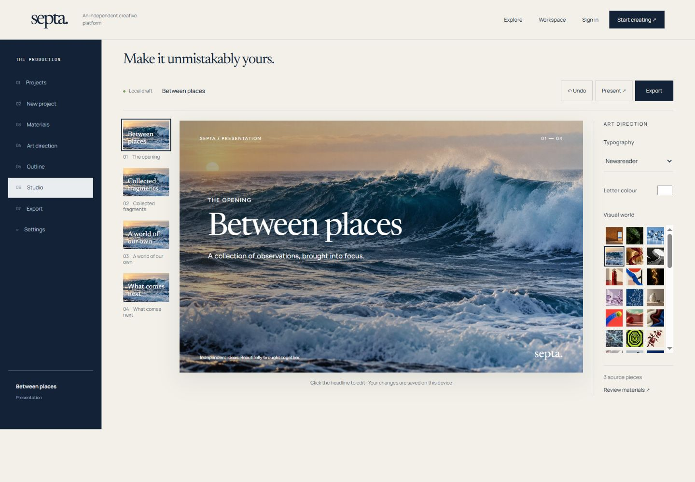
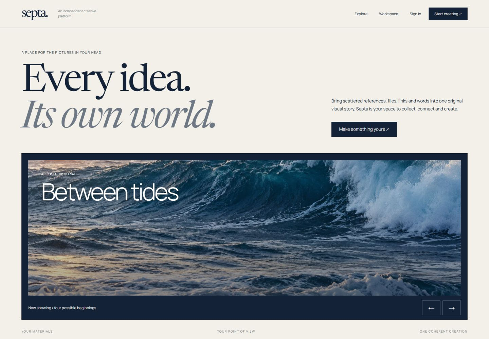
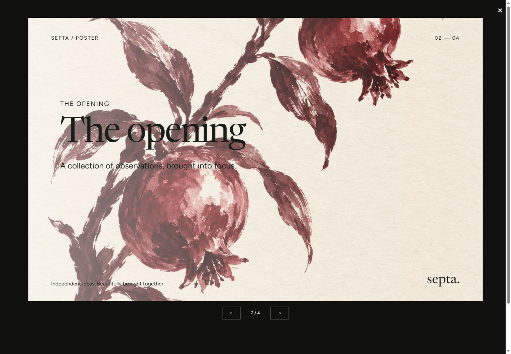

# Septa
### Scattered materials. One editable visual story.

A creative workspace for turning references, documents and a brief into presentations and other visual narratives. Septa treats the output as a structured document that can be edited, inspected and exported, rather than as one flattened image.

*October interface prototype: slide navigation, an editable composition and art-direction controls share the studio.*

## Start with material, not an empty prompt

A useful deck often begins with a mixture of research, links, screenshots, spreadsheets and unfinished notes. The difficult work is deciding what matters, preserving the facts and making those materials feel like one coherent story.

Septa’s workflow separates collection, art direction, outline, studio editing and export. That gives the creator places to make decisions before the final visual pass: which sources belong, what the narrative should say and which visual references should guide it.

*The product entry point frames creation around the user’s materials and point of view.*

## The document remains editable

The underlying studio represents slides as typed scenes: text, shapes, images, charts, groups and motion, with geometry and lock state. The editor, browser presentation and export paths work from that scene representation.

This matters during revision. A headline can be changed without rebuilding the whole slide. A creator can lock a good image or layout region, move an element manually, undo an edit and then request a targeted AI proposal for a selection. The user’s accepted work should remain stable while another part changes.

*Presentation mode in the October design prototype. The sample is authored demonstration content, not a claimed benchmark of autonomous generation.*

## From references to art direction

Reference handling is more specific than choosing “modern” or “minimal.” The generation workflow can describe typography, spacing, rhythm, material, lighting, image crop and other visual relationships in a reference packet. Those decisions then inform a plan for the actual content.

The material pipeline is designed for text, web pages, PDFs, Office documents, spreadsheets, images and audio/video inputs. Extracted content keeps source anchors such as passages, cells and timestamps, so the generation stage can work with evidence instead of receiving an undifferentiated text blob.

## A staged generation system

~~~mermaid
flowchart LR
 A[Brief and source materials] --> B[Extracted evidence]
 B --> C[Outline and reference packet]
 C --> D[Typed scene generation]
 D --> E[Render and inspect]
 E --> F[Bounded repair]
 F --> G[Editable studio]
 G --> H[Browser / PDF / PPTX]
~~~

The implementation uses staged jobs and checkpoints so a long generation does not have to restart from the first prompt after a later failure. Provider attempts and credit reservations are recorded, while render inspection and bounded repair give layout errors a defined correction path. SQLite in WAL mode supplies local durable state.

Provider adapters cover multiple model families and image generation backends. The application-level contract is the useful part: a provider supplies an operation within the pipeline, while the scene model and project state remain under the studio’s control.

## What the current material shows

The gallery presents the October 2026 interface/design prototype with authored sample content. The engineering description reflects the restored studio implementation: source ingestion, typed scenes, manual editing, staged generation and export. These are related development tracks, and the sample screens should not be mistaken for evidence that every provider, input format and export has the same level of completion.

The current architecture is a single-process, single-workspace system. Distributed collaboration, tenant isolation and a full commercial billing service are not established by this showcase. The core result is a practical document model and editing workflow that lets generated material become something a person can continue to shape.

---

### Built by

[Shakhnazar Akhmer](https://github.com/Eye172).

[More projects](https://github.com/Eye172) · [Contact](mailto:shakh090909@gmail.com)

This repository presents the product and its engineering. The implementation is maintained separately. Screenshots and documented experiments are identified in their captions; a live deployment is not required to explore the case study.
