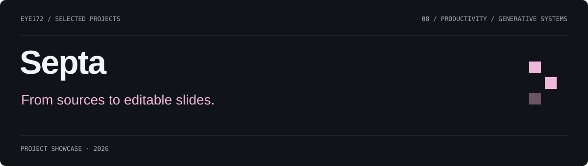
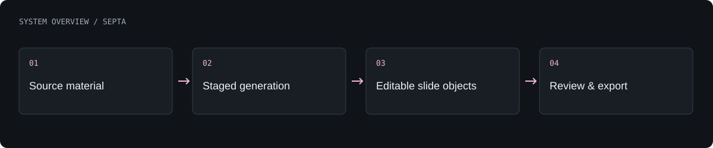

# Septa

A source-based presentation generation and editing system built around editable slide objects.

**Presentation-generation core · under development**

[What is built](#what-is-built) · [Architecture](#architecture) · [Authors](#authors) · [Profile](https://github.com/Eye172)

## What is built

- Ingest sources and carry provenance through staged generation.
- Represent text, images, shapes and charts as typed editable objects.
- Edit slides in the browser with selection, dragging, resizing and undo.
- Save checkpoints and export PDF or PowerPoint outputs.

## Architecture

Generation stages produce a structured slide representation. Provider adapters supply model capabilities, while local checkpoints retain intermediate work. Editing and export consume the same typed presentation model.

**Technology:** TypeScript · Browser editor · Model-provider adapters · PDF / PowerPoint export.

## Current scope

The current implementation is a local, single-workspace core. Multi-user collaboration, billing and large-scale service operation are not established features.

## Authors

[Shakhnazar Akhmer](https://github.com/Eye172).

## About this repository

This is a standalone project showcase containing a product description, visuals and a high-level architecture overview. Implementation source, model weights, credentials and internal project materials are not distributed here. No deployment is required to explore this page.

[Contact](mailto:shakh090909@gmail.com) · [GitHub profile](https://github.com/Eye172)
